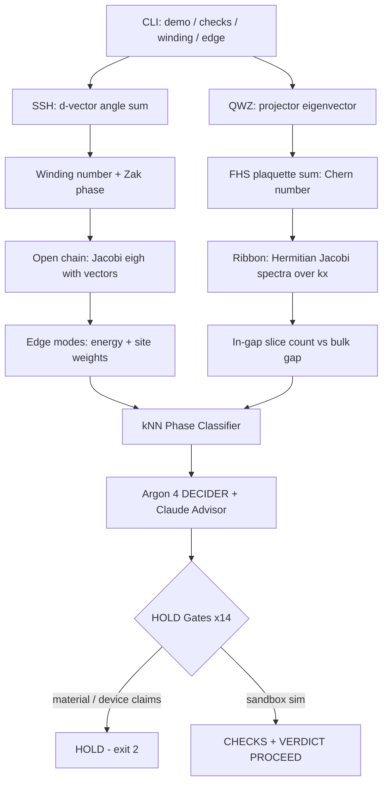
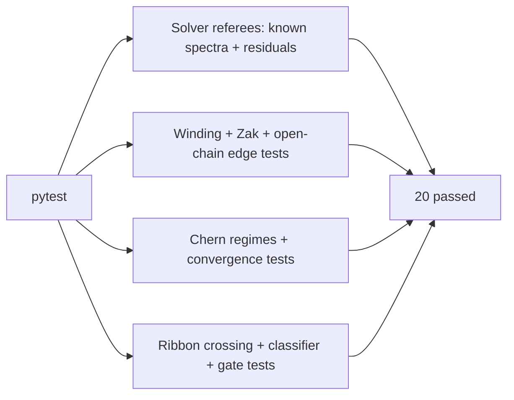
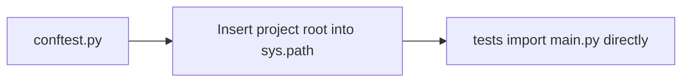
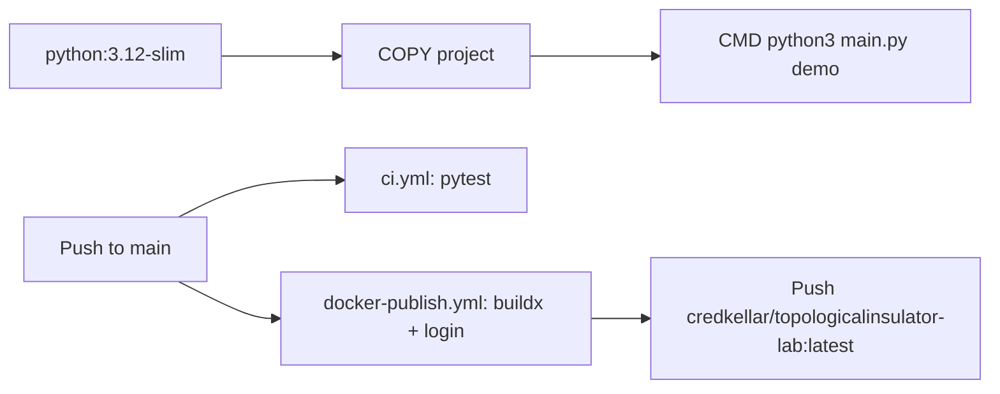

# TopologicalInsulator-Lab 🌀⚛️

**Topological Insulator Lab — SSH Winding, Zak Phase, Edge Modes & QWZ Chern Numbers** — by Darion Kellar

TopologicalInsulator-Lab is an **educational topological-insulator lab** in ONE pure-Python file. It builds the two canonical teaching models of topological band theory from scratch and grades each one's bulk invariant against the boundary spectrum that invariant predicts:

- **The SSH chain** (a dimerised 1D chain): the winding number of the Bloch d-vector, the Zak phase, and the open chain whose ends must host zero-energy modes exactly when the winding is 1. 🔗
- **The Qi–Wu–Zhang (QWZ) model** (a 2D Chern insulator): the Chern number computed by the Fukui–Hatsugai–Suzuki plaquette method, and a ribbon whose edge band must thread the bulk gap exactly when the Chern number is nonzero. 🎗️

Nothing is quoted: the winding is a discretised angle sum that lands on the integer, the Chern number is a finite plaquette sum that is integer on every grid tried, the edge modes are eigenvectors of a from-scratch Jacobi solver whose residuals are checked, and the edge-mode weight is weighed site by site. 🔬

Honest scope, stated up front: these are **two tight-binding Hamiltonians on paper-sized lattices** — no material, sample, or device exists here, no spectrum was measured, and no real-world topological protection is claimed for anything. Every material / device / qubit claim sits behind a permanent HOLD gate (14 total). 🔒

[](https://github.com/kimanicollier44-cmyk/TopologicalInsulator-Lab/actions/workflows/ci.yml)
[](https://github.com/kimanicollier44-cmyk/TopologicalInsulator-Lab/actions/workflows/docker-publish.yml)

> ℹ️ These are the **live** workflow badges for this repo. They activate as soon as the `ci.yml` and `docker-publish.yml` files from the paste pack are pasted into `.github/workflows/` — until then they have nothing to report yet.

## 🧰 Tech Stack Badges & Full Architecture Tech Stack

### 💻 Core Programming Languages & Core Systems


- 🐍 Python 3.12, pure standard library (`math`, `cmath`, `hashlib`, `json`, `sys`) — zero dependencies, zero network, deterministic (double-run byte-identical)
- 🌀 Topology core from scratch: the SSH d-vector angle sum for the winding number, a real-symmetric **Jacobi eigensolver with eigenvectors** for the open chain (refereed by residuals `< 1e-10` before any edge mode is trusted), a complex-Hermitian Jacobi solver for the ribbon (refereed against σy, a complex 2×2, X⊗X + Z⊗Z, and trace invariants), and the **Fukui–Hatsugai–Suzuki** plaquette sum for the Chern number with the lower-band eigenvector taken from the larger column of the projector `(1 − d̂·σ)/2`
- 🎯 Bulk–boundary referee: every invariant is graded against the boundary spectrum it predicts — edge-mode energies as a fraction of the bulk gap, edge weight on end cells vs middle cells, ribbon in-gap state counts slice by slice over kx
- 🧠 TinyML kNN phase classifier (from scratch, stdlib, distance-weighted): trivial-insulator / ssh-topological / chern-insulator / gapless-critical from (SSH winding, QWZ Chern, bulk half-gap), labels from the lab's own policy
- 🪑 Council seats: Gemini Argon 4 DECIDER (names-only, tighten-only) + Muse advisor (never overrides HOLD) + Google Flow plan-only (rendered = False, live = 0)

### ⛓️ Web3 & Infrastructure

- 🚫 **Not applicable — honestly.** No blockchain, no Web3, no tokens: the "infrastructure" in this lab is two lattice Hamiltonians inside one offline file. Real-material and topological-qubit claims are permanent HOLD gates, not features. No fake badges here.

### ⚙️ Platform Support & Hardware Architecture


- 🖥️ Pure Python — runs anywhere Python 3.12+ runs (Linux, macOS, Windows), plus the `python:3.12-slim` Docker image
- 🔒 No hardware is controlled, ever: real samples, cryostats, and fabrication tools are permanent HOLD gates (see the gate table below)

### ⚡ Low-Level Infrastructure & Performance

- 🚫 **No low-level code — honestly.** No C, no C++, no GPU, no compiled extensions: this is one interpreted Python file on purpose, so every invariant can be read, checked, and diffed. Performance here means honest algorithms — cyclic Jacobi rotations with direct row/column updates, an FHS sum whose cost is one pass over plaquettes, and a winding sum over 720 angle steps — all deterministic and byte-identical between runs.

### 🛠️ DevOps & Build Tools


- 🐳 Docker (`python:3.12-slim`), GitHub Actions CI + Docker Publish (delivered in the paste pack)
- 🎯 Target image: `credkellar/topologicalinsulator-lab:latest`
- 🧪 Tests: `pytest` (20 tests) + the built-in CHECKS suite (48 checks) in `main.py`

### ☁️ Cloud Providers

- 🚫 **None — honestly.** No cloud provider is used or needed: the lab runs fully offline on your own machine or in a local Docker container. Docker Hub appears only as the registry the publish workflow pushes the image to.

## What this does?

1. 🌀 **SSH winding number, counted not eyeballed** — the Bloch d-vector `d(k) = (v + w cos k, w sin k)` traces a circle of radius `w` centred at `(v, 0)`; the lab sums wrapped angle steps over 720 points of the Brillouin zone. Across the sweep (v, w) = (2, 1), (1.5, 1), (1.1, 1), (0.9, 1), (0.5, 1), (0.2, 1), (1, 0.5), (1, 2) the sum lands on **exactly 0 for v > w and exactly 1 for v < w** (to < 1e-9) — the circle encloses the origin exactly when the inter-cell hopping wins.
2. 📐 **Zak phase = π × winding** — the geometric phase of the SSH band is printed next to every winding: π in the topological phase, 0 in the trivial phase, asserted to the same tolerance.
3. 🔓 **Open chain: the boundary keeps the bulk's promise** — a 20-cell open chain (40 sites) is diagonalised by the lab's own Jacobi solver (residuals < 1e-10). At v = 0.5, w = 1 exactly **two modes sit inside the bulk gap**, at E = ±7.153e-07 — about **1.4e-6 of the half-gap** 0.5.
4. 🎯 **Edge weight, weighed** — those two modes put **0.7500** of their weight on the two end unit cells and 1.79e-06 on the middle cell — a ratio of **4.19e+05**, asserted above a stated factor of 100. Localisation is a measurement inside the model, not a cartoon.
5. 🚫 **The trivial chain stays clean** — at v = 1.5, w = 1 there are **zero** in-gap modes, and the smallest |E| is 0.5274 — the bulk band edge itself (half-gap 0.5). No edge states appear where the invariant says none may.
6. 🧮 **QWZ Chern number by Fukui plaquettes** — link variables from lower-band eigenvectors (taken from the larger column of the projector, so the gauge never blows up away from a gap closing) give plaquette Berry fluxes whose sum is the Chern number. In this lab's stated convention: **C = +1 for 0 < u < 2, C = −1 for −2 < u < 0, C = 0 for |u| > 2**.
7. 🔁 **Convergence shown, not asserted** — the Chern number is printed at FHS grids N = 8, 12, 16, 24 for each mass: it is the same integer at every grid (agreement < 1e-6), because the FHS sum is exactly integer on any grid that resolves the band.
8. 🎗️ **Ribbon: chiral edge bands** — a ribbon (periodic in x, 10 cells open in y) is scanned over 21 kx slices. At u = +1, **4 slices** carry states inside the gap and the band touches E = 0; at u = −1, **3 slices**; the edge band exists exactly in the Chern phases.
9. 🧱 **The trivial ribbon stays out of its gap** — at u = 3, **zero** of the 21 slices has any state below half the bulk half-gap, and the ribbon's smallest |E| is 1.0667, above the half-gap 1.0. Bulk–boundary correspondence holds in both directions: invariant nonzero ⇔ edge band present.
10. 🏷️ **Phase classifier + seats + checks** — a from-scratch distance-weighted kNN labels scenarios trivial-insulator / ssh-topological / chern-insulator / gapless-critical from (winding, Chern, half-gap) — including the v = w critical point, which it catches by its closed gap — with Argon 4 DECIDER (sha256 trace), Muse advisor, Google Flow plan-only, and a built-in CHECKS suite (48 checks).

## 🗺️ How it works — diagram per script

### `main.py` — the whole lab



### `tests/test_main.py` — verification



### `conftest.py` — test path setup



### `Dockerfile` + CI flow — container & publish



## Why is this cool?

1. 🔢 The winding number **lands on the integer**: a 720-step angle sum returns 0.000000000 or 1.000000000 — topology you can watch being counted.
2. 🎯 Bulk–boundary correspondence is **tested, not recited**: the same file computes the invariant from the bulk and then goes and finds (or fails to find) the edge states it predicts.
3. ⚖️ Edge localisation is **weighed site by site**: 0.7500 of the mode on the end cells vs 1.79e-06 in the middle — a 4.19e+05 ratio from the actual eigenvector.
4. 🧮 The Chern number needs **no gauge fixing**: the FHS plaquette sum is integer on an 8×8 grid already, and the lab prints the whole convergence table.
5. 🎗️ The ribbon shows **chirality's fingerprint**: edge bands thread the gap at u = ±1 and are simply absent at u = 3 — the spectrum itself draws the phase diagram.
6. 🔍 The solvers are **refereed before they are trusted**: known spectra, eigen-residuals, and trace invariants all have to pass before a single physics number is believed.
7. 🧭 The Chern **sign convention is stated, then computed**: +1 for 0 < u < 2 under this lab's plaquette orientation — no sign is ever borrowed from a textbook's different convention.
8. 🪞 The trivial phases are **as informative as the topological ones**: min |E| = 0.5274 (the band edge) and a ribbon that stays out of its gap prove the machinery can say "nothing here".
9. 🏷️ Even the **critical point** is classified honestly: at v = w the gap closes and the kNN files it as gapless-critical instead of forcing a phase label.
10. 🎯 Deterministic end to end: run it twice, get byte-identical output — a topological phase diagram you can diff.

## What problems this solves?

1. ❌ **Problem:** "Topological" is often asserted from a band picture without computing any invariant. ✅ **Solution:** Both invariants are computed from the wavefunctions — an angle sum for the winding, a plaquette flux sum for the Chern number.
2. ❌ **Problem:** Winding numbers get read off plots by eye. ✅ **Solution:** The discretised integral is summed in code and asserted to hit 0 or 1 to < 1e-9 across an 8-point sweep.
3. ❌ **Problem:** Edge states are drawn as cartoons at the chain ends. ✅ **Solution:** The open chain is diagonalised and the eigenvector weight is reported per region: ends 0.7500, middle 1.79e-06.
4. ❌ **Problem:** Chern-number signs flip silently between conventions. ✅ **Solution:** The convention (Hamiltonian, plaquette orientation, log branch) is stated once at the top of the file, and the computed signs are reported under it.
5. ❌ **Problem:** Numerical Chern calculations are suspected of drifting with grid size. ✅ **Solution:** The N = 8 → 24 convergence table is printed in the demo and asserted in CHECKS.
6. ❌ **Problem:** "Protected edge modes" get promised for real devices from toy models. ✅ **Solution:** `topological_qubit_claim` and `fault_tolerance_claim` are permanent HOLD gates; the lab claims protection only inside its own Hamiltonian.
7. ❌ **Problem:** A solver bug can manufacture fake zero modes. ✅ **Solution:** Jacobi residuals < 1e-10, known-spectrum referees, and ribbon trace invariants gate every physics claim.
8. ❌ **Problem:** Phase diagrams hide the critical point between phases. ✅ **Solution:** The v = w gap closing is a first-class scenario, labelled gapless-critical by policy and classifier alike.
9. ❌ **Problem:** Ribbon spectra are shown without a bulk reference. ✅ **Solution:** Every ribbon count is taken against the computed bulk half-gap at the same mass, with the threshold stated (half the half-gap).
10. ❌ **Problem:** Simulation tools quietly imply a material or product is next. ✅ **Solution:** 14 named HOLD gates return exit code 2 for every real-material, device, fabrication, or certification claim, forever.

## How to install this?

1. 📋 Clone or download this project folder.
2. 🐍 Make sure Python 3.12+ is installed: `python3 --version`
3. ▶️ Run the full demo + checks (no arguments needed):

```bash
python3 main.py
```

4. 🧪 Run the test suite:

```bash
pip install pytest
python3 -m pytest -q
```

5. 🎛️ Try the other commands:

```bash
python3 main.py checks    # 48 built-in checks
python3 main.py winding   # SSH winding + Zak phase sweep (JSON)
python3 main.py edge      # open-chain edge-mode reports (JSON)
python3 main.py chern     # QWZ Chern numbers + convergence (JSON)
python3 main.py ribbon    # ribbon in-gap slice counts (JSON)
python3 main.py classify  # kNN phase classifier report
python3 main.py brains    # Argon 4 + Muse + Flow seats
python3 main.py holds     # list all 14 HOLD gates
python3 main.py hold-demo # exits 2 - gated actions stay HOLD
```

6. 🐳 Or run it in Docker:

```bash
docker build -t credkellar/topologicalinsulator-lab:latest .
docker run --rm credkellar/topologicalinsulator-lab:latest
```

## Requirements

- 🐍 Python 3.12 or newer
- 📦 Dependencies: **none** (standard library only)
- 🌐 Network: **none** — fully offline
- 🧪 For tests only: `pytest`
- 🐳 Optional: Docker

## FULL project structure tree

```text
topologicalinsulator-lab/
├── main.py                  # the whole lab: SSH winding + Zak phase, open-chain edge modes, QWZ FHS Chern numbers, ribbon spectra, classifier, seats, HOLD gates
├── conftest.py              # puts the project root on sys.path for tests
├── tests/
│   └── test_main.py         # 20 pytest tests: solvers, winding, edge modes, Chern regimes, ribbon, classifier, gates, determinism
├── assets/
│   └── cover.png            # README cover image (2736 x 912)
├── Dockerfile               # python:3.12-slim, runs the demo
├── .gitignore               # __pycache__/, .pytest_cache/, *.pyc
└── README.md                # this file
```

> 📦 Delivered separately as paste packs (not in this tree): `.github/workflows/ci.yml` + `docker-publish.yml`, and the Docker Hub pack (100-char description, 350-char About, overview, categories).

## 🔒 HOLD gates — all 14, permanent

| # | Gate | What stays held |
|---|------|-----------------|
| 1 | `real_material_claim` | No claim that any real material is or is not a topological insulator follows from two toy Hamiltonians |
| 2 | `device_prototype_claim` | No device, prototype, or component claim is made or certified here |
| 3 | `topological_qubit_claim` | No topological-qubit, Majorana-hardware, or braiding claim is simulated or validated here |
| 4 | `fault_tolerance_claim` | No fault-tolerance, error-rate, or protection guarantee for any real hardware |
| 5 | `spintronics_product_claim` | No spintronics product, memory, or logic claim from a lattice model |
| 6 | `quantum_computer_claim` | No claim that this lab simulates, benchmarks, or advances a quantum computer |
| 7 | `experimental_data_claim` | No experimental data is produced; every number is a statement about the stated model |
| 8 | `sample_growth_guidance` | No crystal-growth, deposition, or fabrication guidance for real samples |
| 9 | `vendor_material_claim` | No vendor material, wafer, or instrument figure is stated, endorsed, or compared |
| 10 | `room_temperature_claim` | No room-temperature (or any-temperature) operation claim for any real system |
| 11 | `certification_claim` | No certification that any material or system meets any standard |
| 12 | `investment_claim` | No investment claim; a lab model is not a prospectus |
| 13 | `live_hardware_control` | No control of real samples, cryostats, or laboratory hardware, ever |
| 14 | `model_as_measurement_claim` | A computed invariant is a property of the model at stated inputs, never a measurement |

🧑‍⚖️ **Council seats:** Gemini Argon 4 Extended Thinking — DECIDER (names-only, tighten-only, MAP → MODEL → STRESS → DECIDE, sha256 trace, `can_override_hold = False`) · Muse — advisor (`can_override_hold = False`) · Google Flow — plan-only (`rendered = False`, `live = 0`).

✅ **Verification:** pytest **20 passed** (project + clean copy) · built-in CHECKS **48/48** · double-run output **byte-identical** · `hold-demo` exits **2** · `main.py` **846 lines**, pure stdlib, zero network.

## 🧒 5th-grade English section

Imagine a row of magnets on a string, tied together by two kinds of springs that take turns: a short spring, then a long spring, then a short one again. 🧲

- If the **long springs are on the outside ends** of each pair, something magical happens: the two ends of the string get a special wobble that costs almost **no energy at all**, and it refuses to move into the middle — this lab weighs it: 3/4 of the wobble sits on the end pairs and almost none in the middle. 🪢
- There is a number that **counts loops**: draw the path the springs' tug makes as you walk through all the wobble speeds. If the path circles around the middle point, the count is **1** and the end wobbles must exist. If it misses, the count is **0** and there are none. The count cannot be 1.5 — it is a whole number, and it can only change if the whole string's "energy gap" closes up first. 🔢
- The lab also builds a tiny **checkerboard world** where the count is called the Chern number. It adds up tiny twists on every square of the board — and the total is always a whole number: +1, −1, or 0. When it is not zero, a one-way path appears along the edge of the board, like a sidewalk that only lets you walk one direction. 🚶
- None of this is a real material. It is a **pretend lab on a computer** that shows why these loop-counts are so trustworthy: they are arithmetic, and arithmetic does not drift. 💻

---

MIT © 2026 Darion Kellar · TopologicalInsulator-Lab — educational simulation only 🌀
